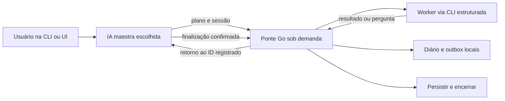

# Desenho e decisões vigentes

Status em 21/10/2026: implementações e testes de T01–T08 estão presentes; a restauração do adaptador Go em T06 requer correção e verificação. A arquitetura abaixo incorpora o resultado de T01; o ensaio ponta a ponta e o suporte por superfície ainda dependem de T09–T12.

## Componentes mínimos

| Componente | Responsabilidade |
| --- | --- |
| Comando de entrada | Receber plano e sessão de retorno; iniciar/reutilizar o processo da execução |
| Runtime Go | Ser dono do estado, fila, limites e processos; não fazer decisões de domínio por LLM |
| Adaptador por provedor | Traduzir início, eventos, sessão/modelo, resposta, erro e encerramento |
| Adaptador de retorno ao host | Entregar ao chat original por canal suportado; comprovar novo turno e processamento |
| Diário e outbox | Persistir eventos/entregas e evidências mínimas para recuperar após crash |
| Skill portátil | Ensinar a maestra a planejar, chamar a ponte, encerrar aguardando e processar o retorno |

mermaid-studio não encontrado nos dois diretórios globais consultados; diagrama inline suficiente neste plano. É opcional instalar mermaid-studio para renderização futura, sem bloquear o projeto.

## Ciclo de vida

Estados da execução: `starting`, `running`, `waiting`, `awaiting_user`, `completing`, `completed`, `failed`, `interrupted`. Estados de entrega são independentes: `persisted`, `enqueued`, `turn_started`, `processed`, `acknowledged`, `unknown`.

A maestra pode estar sem turno ativo e a ponte continuar em `waiting`. A ponte só fecha ao satisfazer R10, sob exclusão mútua com novos envios. Uma pergunta pode suspender o fluxo com estado salvo; enquanto houver worker capaz de produzir resposta, um receptor deve continuar ativo. Caso todos os processos sejam parados explicitamente, não há evento ao vivo até nova ativação.

## Transporte proposto

Um único processo Go por execução e um cliente leve para chamadas dos agentes. Em Windows, escolher IPC local com lock e identidade da execução; o transporte exato será decidido no spike, priorizando pipes/stdio ou endpoint restrito ao loopback. Não publicar listener na rede.

Workers por processos com argv separado e pipes, sem montar comandos a partir de texto do modelo. Respostas chegam pelos eventos do provedor; não raspar o terminal visual. A ponte não usa notificações MCP como prova de que o host iniciará outro turno.

**Modos de retorno à maestra (decisão de 21/10/2026 após T01):**
1. **Espera bloqueante no processo da ponte (padrão universal para Codex Desktop e Antigravity IDE):** A maestra invoca a ponte Go via ferramenta de comando e aguarda o processo da ponte concluir. O processo Go aguarda o worker terminar no nível do SO (zero inferência/polling de LLM durante a espera), grava no diário/outbox e devolve o evento/relatório estruturado no `stdout` para consolidação imediata pela maestra. No Antigravity IDE, caso o comando passe para background task, o término do processo Go desperta o chat nativamente via `<SYSTEM_MESSAGE>`.
2. **Callback assíncrono pós-turno (`codex queue` / `app-server`):** Utilizado apenas quando a sessão maestra rodar sobre daemon/CLI que exponha endpoint verificável. No Codex Desktop (cujo `app-server` interno não expõe `app-server-control.sock`), usa-se o modo 1.

**Isolamento MCP para worker AGY headless (T01):**
O ensaio aprovado esvaziou temporariamente `mcpServers` em `~/.gemini/config/mcp_config.json` durante a execução headless e restaurou os bytes originais com conferência SHA-256. O override `.agents/mcp_config.json` e `disabled: true` não impediram inicializações MCP nesta instalação. O código atual esvazia todos os MCPs em cada chamada configurada com auto-skip; o teste Python verificou restauração, mas isso não demonstra coordenação com processos AGY externos. O mutex do adaptador Go protege apenas a mesma instância e `RunTask` descarta erro de restauração. São lacunas a resolver antes do uso concorrente ou do T09. O T01 aprovado não valida o retorno ao host nem o fluxo completo.

**Estado da implementação:** O código e os testes de T01–T08 estão presentes; o aceite de restauração Go em T06 segue aberto até `RunTask` propagar o erro de `restore()` e haver coordenação entre instâncias/processos AGY. O ensaio T01 validou o script Python, não esse caminho Go.

## Contrato normalizado

Evento mínimo: `event_id`, `run_id`, `task_id`, `attempt_id`, `source_provider`, `source_session_id`, `destination_session_id`, `type`, `status`, `summary`, `artifact_refs`, `occurred_at`, `usage?`.

As IDs de origem, destino e tentativa são resolvidas no início. Não usar nomes ambíguos ou "última conversa". Contrato proposto da maestra: `delegate`, `wait`, `finish`, `ask_user`; o parser rejeita ações desconhecidas. Um worker responde ao escopo, não ganha autoridade para reconfigurar o fluxo. Conteúdo de fontes e resultados externos continua sendo dado, sem virar instrução executável.

## Persistência e entrega

Proposta: diário JSONL e snapshots por execução, outbox gravada antes do envio; um escritor por execução. Estado operacional em `%LOCALAPPDATA%/SimpleOrchestrator`, para evitar disputas com sincronização do OneDrive, onde está o código deste projeto. Relatórios exportados somente para diretório autorizado.

O diário é a fonte de recuperação, não um arquivo de conclusão escrito pelo modelo. Tratar duplicatas por chave de evento e tentativa. Exactly-once entre aplicações não é garantia geral: se o host não aceitar chave de deduplicação ou permitir consulta do recibo, uma entrega ambígua exige reconciliação/intervenção. Não repetir inferência automaticamente após perder a confirmação.

No reinício, validar o último registro completo, snapshot e outbox. Apenas processos próprios comprovados podem ser encerrados. Evitar mutexes em pastas sincronizadas; controlar startup duplo e limpeza após crash.

## Acompanhamento ao vivo por terminal (decisão de 23/10/2026)

Motivação: as UIs do Codex Desktop/VS Code e do Antigravity não exibem em tempo real conversas iniciadas por fora. Cada UI roda seu próprio `codex app-server` por stdio e só relê `state_5.sqlite` ao recarregar; o Antigravity só renderiza o turno após o processo `agy` concluir. A sincronização de metadados mantém o histórico visível depois, mas não serve para acompanhar.

Desenho implementado em `internal/monitor` (T08A, 23/10/2026):

1. A ponte permanece dona do processo do worker (`codex exec --json` / `agy`), capturando o stream estruturado e devolvendo o resultado como hoje.
2. Em paralelo, grava um log legível e append-only por tentativa em `<estado>/live/<run>/<task>-<tentativa>.live.log` (`%LOCALAPPDATA%/SimpleOrchestrator` por padrão), com mensagens do agente, comandos, arquivos alterados, status e, ao final, resumo, status terminal, modelo observado e uso exposto. O engine cria o log e o injeta no `context`; os adaptadores Codex e Antigravity escrevem cada linha do stream nele.
3. Ao iniciar o worker, abre sempre um terminal que apenas segue esse log: Windows Terminal (`wt new-tab ...`) quando disponível, senão `start powershell`, com título identificando execução, provedor e tarefa. O terminal permanece aberto após o término, mostrando o resumo.
4. O terminal não é processo próprio da ponte para fins de desligamento: fechar a janela não afeta a tarefa, e o autoencerramento (R10) não depende dele. Falha ao abrir é registrada no log e não bloqueia a delegação. `delegate --no-watch` desativa a abertura (o log continua sendo gravado); os testes substituem o abridor para nunca abrir janelas reais. O formato dos eventos intermediários do AGY ainda não foi observado ao vivo: o formatador mostra `init`/`result` e um texto genérico para os demais, a refinar no T09.
5. O log não entra no prompt de nenhum modelo e não gera inferência extra (R06).

Modo `--watch-native` (23/10/2026, **padrão**, Codex e Antigravity): em vez do stream estruturado, a ponte abre a **tela interativa** da CLI do worker num console próprio, com a tarefa como primeiro prompt. Codex: `codex [resume <id>] --model … --ask-for-approval never [--sandbox read-only] --cd <workspace> "<prompt>"`. Antigravity: `agy --mode auto --dangerously-skip-permissions [--conversation <id>] [--project …] --model … --effort … -i "<prompt>"`, sem isolar os MCPs globais (o travamento do T01 era do modo headless). `--watch-native=false` volta ao worker headless com o terminal de log; `--no-watch` não abre janela.

Abertura da janela: `CreateProcess` direto com console novo e `CREATE_BREAKAWAY_FROM_JOB`, sem passar por shell (o shim `codex.cmd` é contornado chamando `node.exe codex.js`), porque o `os/exec` sempre redireciona o stdin para NUL e a TUI rejeita (`stdin is not a terminal`). Quando o job de quem chamou nega o breakaway (caso do `run_command` do Antigravity, que mataria a janela no fim do comando), a janela é criada via WMI (`Win32_Process.Create`), fora desse job, por um wrapper PowerShell que repassa os argumentos já escapados (`ProcessStartInfo.Arguments`). Em último caso, abre presa ao job. Em todos os caminhos o worker recebe `CI=true`.

Fim do turno (a TUI não termina sozinha): **Codex** — a ponte acompanha o arquivo de sessão (`sessions/**/rollout-*.jsonl`, localizado por um marcador único no prompt, ou pelo ID no nome quando for `resume`) e conclui no primeiro `task_complete` com `timestamp` posterior ao início; `turn_aborted` ou `error` nesse turno contam como falha (R07). **Antigravity** — não há evento explícito: exige `CASCADE_RUN_STATUS_IDLE` e `not_fully_idle = 0` em `conversation_summaries.db` e uma resposta final do modelo (sem tool calls) no `brain/<id>/.system_generated/logs/transcript.jsonl` depois do prompt delegado; passo final com `ERROR`, conversa `killed` ou turno sem resposta final contam como falha. Modelo observado: lido do arquivo de sessão no Codex; `unknown` no AGY (o transcript não o registra). Uso só para chats novos (contadores cumulativos). A janela continua aberta depois; turnos digitados nela não entram no resultado. Fechar a janela antes do fim do turno interrompe a tarefa (a ponte detecta e falha com motivo); em timeout a ponte encerra a árvore do processo. Evidência real em `docs/validation/first-pair.md`.

## Copilot (experimental, 23/10/2026)

Adaptador em `internal/providers/copilot`, desligado por padrão (`--experimental-copilot`). Exige `--model` e `--effort` explícitos (`auto` é recusado, pois não aceita esforço). A ponte define o UUID da sessão nova (`--session-id`) e nomeia o chat (`-n`); retomada por `--resume <id>`. Sem tela: `copilot -p … --output-format json`, fim pelo evento `result`. Interativo: `copilot -i …`, fim quando `assistant.turn_end` segue um `assistant.message` sem `toolRequests` em `~/.copilot/session-state/<id>/events.jsonl` (cada passo com ferramenta também termina com `turn_end`, por isso não basta). Troca de modelo (`session.error` com `errorType: "model"`, `session.model_change` para outro modelo, ou `assistant.message` com outro `model`) falha a tarefa e encerra a janela, porque a CLI interativa troca o modelo indisponível por `auto` sem parar. Uso somado dos `session.usage_record` posteriores ao início (registros por chamada, válidos também em sessões retomadas). `--read-only` vira `--deny-tool write`.

## Perfis, contexto e limites

Perfil contém provedor, caminho da CLI, modelo explícito ou padrão declarado, esforço suportado, papel, permissões, timeout, máximo de turnos e fallback autorizado. Separar `requested_model` de `observed_model`. Catálogo/documentação não provam cota disponível.

Passar objetivo, restrições, aceite e trechos necessários. Logs integrais ficam fora do prompt. Resultados curtos referenciam evidências; cortar o resumo não deve esconder lacunas. Contagem de inferências indevidas durante espera deve ser zero. Não há inferência extra só para resumir progresso a cada evento de ferramenta.

## Skills e reaproveitamento

Reusar princípios do orca-flow: descoberta, grill-me, menor equipe, IDs atuais, evidência antes de sucesso e checkpoint curto. Não copiar seu contrato operacional Orca. A skill portátil será criada após estabilizar a CLI da ponte, usando skill-creator; tlc-spec-driven continua responsável por spec, desenho e tarefas. Skills Go são auxiliares de implementação, carregadas sob demanda.

## Matriz de testes proposta e aceita para o planejamento

O usuário escolheu simulações e teste real curto. Testes junto à implementação de cada componente; simulações sem acesso aos provedores e sem credenciais.

| Camada | Tipo necessário | Gate proposto | Paralelo seguro |
| --- | --- | --- | --- |
| Contratos/eventos | Unitário | `go test ./...`; `go vet ./...` | Sim, sem estado compartilhado |
| Persistência | Unitário + integração em diretório temporário | Os mesmos; cenários de truncamento/duplicata/crash | Sim, diretórios isolados |
| Runtime e CLI | Integração com executáveis simulados | Os mesmos; contagem de processos/entregas/tempo de espera | Não no ensaio que mede ciclo de vida |
| Adaptadores | Unitário com fixtures + integração simulada | Os mesmos; parser, erros, modelo e sessão | Sim, fixtures/processos isolados |
| Host nativo | Ensaio real curto autorizado | Novo turno e retorno observados no mesmo chat; recibo e relatório | Não, proprietário único da sessão |
| Skill/documentação | Inspeção de comandos, links e escopo | Comandos correspondem ao `--help`; nenhum comando inventado | Sem necessidade de paralelizar |

`go test -race ./...` é adicional quando o toolchain Windows tiver suporte/CGo adequado. Não declarar esse gate executado nem exigir instalação implícita de compiladores para o plano. O ensaio real terá limites explícitos de tarefas e turnos antes de iniciar.
